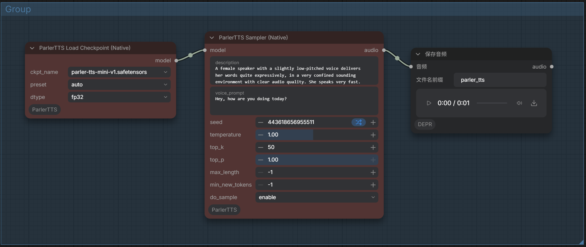

# ComfyUI_ParlerTTS
Parler-TTS is a lightweight text-to-speech (TTS) model that can generate high-quality, natural sounding speech in the style of a given speaker (gender, pitch, speaking style, etc).
This is a simple ComfyUI custom node based on Parler_tts. 

You can find the project for Parler-TTS here: [Parler-TTS](https://github.com/huggingface/parler-tts) 

## Update log
* 使用comfyUI的核心封装，去掉transformer的版本限制/used comfyUI core encapsulation, remove transformer version limit

1.Installation
-----
 In the .\ComfyUI\custom_nodes directory, run the following:  

``` 
  git clone https://github.com/smthemex/ComfyUI_ParlerTTS.git
```


2 Checkpoints
---
* 2.1 download mini  model from [parler-tts/parler-tts-mini-v1](https://huggingface.co/parler-tts/parler-tts-mini-v1) 从抱脸下载模型;  
* 2.2 download mergerd large  model from [smthem/parler-tts-large-v1](https://huggingface.co/smthem/parler-tts-large-v1) 从抱脸下载模型; 
```
--  ComfyUI/models/clip/
    |-- parler-tts-mini-v1.safetensors # rename form model.safetensor ,or larger model
```


3.Example   
-------
  


4.Citation
------
If you found this repository useful, please consider citing this work and also the original Stability AI paper:  
```   
@misc{lacombe-etal-2024-parler-tts,
  author = {Yoach Lacombe and Vaibhav Srivastav and Sanchit Gandhi},
  title = {Parler-TTS},
  year = {2024},
  publisher = {GitHub},
  journal = {GitHub repository},
  howpublished = {\url{https://github.com/huggingface/parler-tts}}
}

@misc{lyth2024natural,
      title={Natural language guidance of high-fidelity text-to-speech with synthetic annotations},
      author={Dan Lyth and Simon King},
      year={2024},
      eprint={2402.01912},
      archivePrefix={arXiv},
      primaryClass={cs.SD}
}
```
